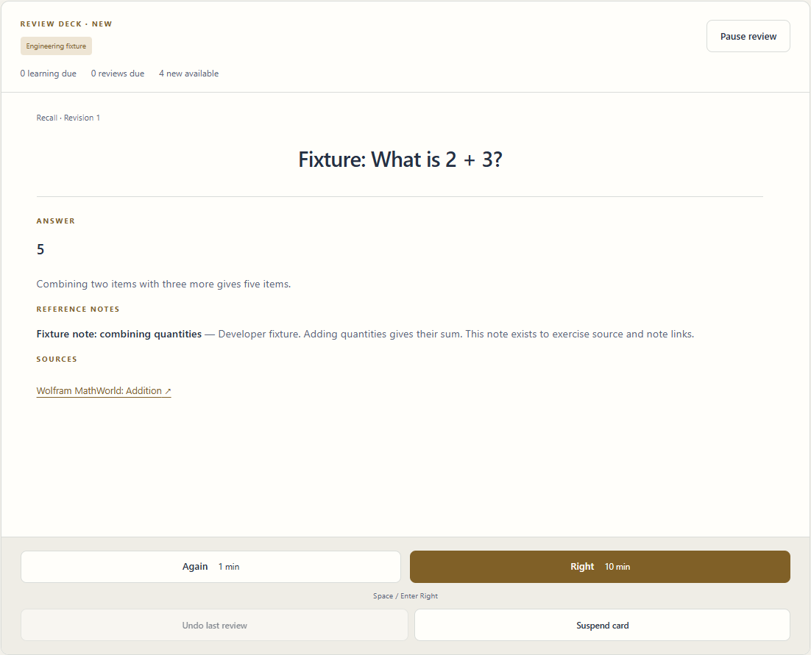
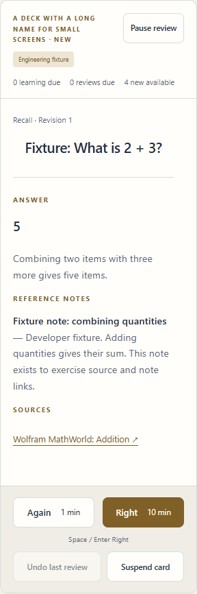

# Phase 2 review — 月明かり / Tsukiakari

Status: complete for user review. Phase 3 is not authorized.

## Delivered

- Per-deck FSRS scheduling with Again / Right, standard FSRS-6 parameters, 90% retention default, and retained review logs for later optimization.
- Default 20 new introductions and 9999 Review-stage answers per day, independently tracked for each deck.
- Learning steps 1m / 10m / 1h and relearning steps 10m / 1h. Due steps take priority and remain available after daily review limits are reached.
- Saved-timezone 05:00 rollover, DST-aware long-term due dates, exact minute delays, overdue queues, and automatic count updates while the page is open. No nightly server job is needed.
- A working review panel with answer reveal, sources, reference notes, MCQ selection/guessed state, keyboard controls, interval previews, pause/resume, and reload-safe session state.
- Atomic review commits and one-level Undo last review, restoring schedule, card, daily allowance, and leech effects. Duplicate submissions cannot double-record an answer; failed saves preserve the current answer.
- Leech tagging and default suspension after ten Review-stage lapses. Initial/relearning failures do not increment leech lapses. Tag-only behavior and manual suspension/unsuspension are available.
- Per-deck scheduling settings. Updating one deck does not interrupt another deck's study.
- Active review timing excludes background and paused time and stops counting after 30 seconds of inactivity. A tab-local timing checkpoint carries an unfinished card's duration through pause/navigation/reload; completed duration is committed with its review.

## Try it

The running development preview is http://localhost:5186.

1. Create a deck on Study.
2. Open Library, choose that deck, and add the four engineering fixtures.
3. Return to Study and select Study for the deck.
4. Reveal an answer; inspect its reference notes and source; choose Again or Right.
5. Select Undo last review. The same revealed card returns and the new-card allowance is restored.
6. Reload and continue. Pause/resume also keeps the revealed answer.
7. In Settings, select a deck and change its limits or steps. Set New cards/day to 1 and Reviews/day to 0, rate a new card Again, and return after one minute: its learning step is still available.
8. Expand Card suspension in Settings to suspend or unsuspend that deck's copy.

Right on a new card advances directly to the second learning step (10m by default), matching the pinned FSRS Good behavior. Again starts at 1m.

## Checks actually run

| Check | Result |
|---|---|
| npm run lint | Passed, including final browser-test additions |
| npm test | 115 unit/content tests passed across 7 files |
| npm run build | Passed; production assets generated |
| npm run test:e2e | Full integration run passed all 17 tests present at that point |
| npx playwright test tests/e2e/phase2.spec.ts | Final focused run passed 7 tests, including the added pause/reload timing regression |
| Total distinct browser checks | 18 passed: 11 foundation checks and 7 Phase 2 checks |
| Visual review | Desktop 1440px and mobile 320px review screenshots inspected |
| Live preview | HTTP 200 and Phase 2 UI verified in the in-app browser |

Coverage includes deck isolation, 05:00 rollover, both DST transitions, UTC-midnight regressions, overdue and suspended cards, shortened step settings, retained FSRS metadata, transaction rollback at multiple write points, duplicate answer protection, leech actions/undo, invalid state preservation, session reload, wrong MCQ handling, read-only tabs, active-time pause/reload, and responsive layout.

The separate Phase 1 dependency probe was not rerun: the exact dependency and probe are unchanged, and the application scheduler is now exercised directly by unit and real-browser tests.

## Review images

## Boundaries

- Engineering fixtures only. No real study packs, old-site material, or exam question pools were added.
- Full card browser/history, deck editing, personal annotations, and Mistakes are Phase 3.
- Practice/exam workflows are Phase 4; JSON transfer and statistics/heatmap are Phase 5; final design is Phase 6.
- No optimizer, cloud services, accounts, offline/PWA support, deployment, commits, or pushes were added.
- Source remains local and uncommitted in the independent private-repository checkout.
- Browser tests use Edge with isolated storage on port 4187. Physical phones, Safari, and Firefox were not tested.
- A browser that denies sessionStorage can still save reviews; only the optional unfinished-card timing checkpoint is lost on reload. Browser crashes can lose time since the last interaction or visibility checkpoint.
- Undo is intentionally one level. Settings or suspension changes in the same deck and switching decks end its availability. Unsuspending a leech retains its lapse count; the next qualifying lapse may suspend it again.

## Team

Scheduler agent: FSRS adapter, study-day arithmetic, and 34 regression checks.
Storage agent: review transactions, undo, leeches, corruption protection, and 26 new transaction checks.
Interface agent: review screen, settings, suspension controls, and browser regressions.
Lead: shared contracts, validation, active-time integration, failure review, complete verification, visual inspection, and phase handoff.

Detailed behavior and policy: [Scheduling](SCHEDULING.md).
Stop here for the user's decision on Phase 3.
